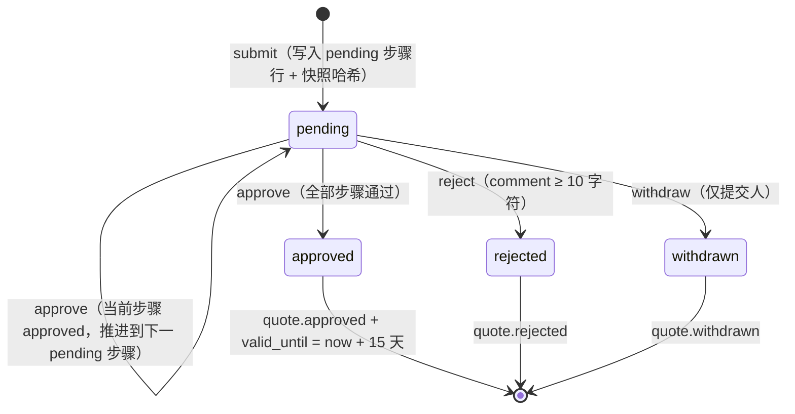

# 报价审批流转接口（可运行演示）

按报价层级（tier）自动路由审批步骤，提供提交、待办/我发起/已处理列表、批准、驳回、撤回五类接口。覆盖两表模型、SHA-256 快照防御性校验、append-only 步骤日志、24 小时审批人提醒与 48 小时会所经理通知、报价通过后 15 天有效期与 `quote.approved` 领域事件。所有人员、报价、金额均为**虚构合成数据**，无真实个人信息、无外部服务。

源码与交付目录：本地目录（未做 git 初始化或推送）。

## 技术栈（均为 MIT / Apache-2.0 / BSD 许可）
- 前端演示：React 18 + Vite 6（JSX）
- 服务：Express 4（Node 22）
- 测试：Playwright，复用系统 Edge（`channel: 'msedge'`，不下载 Chromium）
- 容器：Node 22 Alpine 官方镜像
- 哈希：Node 内置 `crypto` 的 SHA-256；时间冻结：注入式 `now` 函数
- 无新增第三方依赖

## 一键启动
```bash
# 方式 A：Docker
docker compose up --build
#   演示台 http://localhost:4173   Mock API http://localhost:3001/api/v1/health

# 方式 B：本机开发
npm install
npm run dev:all          # mock:3001 + Vite:5173，打开 http://localhost:5173

# 方式 C：本机生产预览（模拟容器）
npm install && npm run build && node server.js
#   演示台 http://localhost:4173，/api 自动代理到 3001
```

## 两表模型
| 表 | 关键列 | 语义 |
|---|---|---|
| `sales_quote_approvals` | `id, quote_id, revision, tier, status, submitted_by, submitted_at, snapshot_hash` | 每次提交生成一条审批记录；`snapshot_hash` 为提交时 `calc_snapshot` 的 SHA-256 |
| `sales_quote_approval_steps` | `id, approval_id, step_no, approver_id, approver_role, action, comment, acted_at, client_ip` | **append-only**：每次动作追加新行，从不 UPDATE；某步骤当前动作取该 `step_no` 最大 id 的行 |

迁移脚本见 `migrations/001_create_quote_approvals.sql` 与 `migrations/002_create_quote_approval_steps.sql`。

`status`：`pending / approved / rejected / withdrawn`；`action`：`pending / approved / rejected / skipped`。
当前步骤由最新一行 `action=pending` 推导，因此撤回与驳回会给剩余步骤追加 `skipped` 行。

## 层级路由规则
| tier | 权限上限 | 步骤序列 | 结果 |
|---|---|---|---|
| `rep` | 1,000 | 提交人自审一步 | 提交时直接置报价 `approved`，写入 `action=approved`、`comment="Within advisor's authority"` |
| `supervisor` | 10,000 | 主管（supervisor） | 主管批准后报价生效 |
| `site_manager` | 100,000 | 主管 → 会所经理 | 两步**依次**批准后报价才 `approved` |

金额超过所在层级权限上限返回 `422 QUOTE_EXCEEDS_MAX_AUTHORITY`（未知层级 `422 UNKNOWN_TIER`），不创建审批记录。路由逻辑在 `mock-server/router.js`，为纯函数，便于单独复核。

## 审批状态流转图



## 核心约束
- **仅当前步骤审批人可操作**：approve / reject 比较 `actor_id` 与当前步骤 `approver_id`，不符返回 `403 NOT_CURRENT_APPROVER`；撤回仅提交人，返回 `403 NOT_SUBMITTER`。
- **快照防御性校验**：每次批准或驳回都重新计算报价 `calc_snapshot` 的确定性 SHA-256（键排序后的 canonical JSON），与 `snapshot_hash` 不符返回 `409 QUOTE_CHANGED_SINCE_SUBMIT`。
- **全部通过**：报价置 `approved`、`valid_until = 注入时间 + 15 天`、发 `quote.approved` 事件；任一步驳回则报价置 `rejected`。
- **超时提醒**：某步骤 pending 满 24 小时提醒该步骤审批人，满 48 小时再通知会所经理。通知为进程内 stub（`GET /api/v1/notifications`），不调用外部接口；同一 `(审批, 步骤, 级别)` 只提醒一次。
- **注入时钟**：`POST /api/v1/test/set-now` 接受 ISO 时间；`null` 恢复真实时钟。所有时间戳、有效期与超时计算统一走该时钟，便于冻结时间验证。

## API 一览
| 方法 | 路径 | 说明 |
|---|---|---|
| GET | `/api/v1/health` | 健康检查 |
| POST | `/api/v1/test/reset` | 重置内存数据（测试用） |
| POST | `/api/v1/test/set-now` | 注入 / 恢复时钟（测试用） |
| POST | `/api/v1/test/tamper-snapshot` | 篡改报价快照（测试防御校验用） |
| POST | `/api/v1/test/seed-quote` | 造一条虚构报价（测试用） |
| GET | `/api/v1/meta` | 层级、路由、阈值、actor 注册表 |
| GET | `/api/v1/sales/quotes` `/quotes/:qid` | 报价列表 / 详情（含当前哈希） |
| POST | `/api/v1/sales/quotes/:qid/submit` | 提交审批，返回审批单 |
| GET | `/api/v1/sales/approvals?tab=todo\|mine\|done&actor_id=` | 审批列表（支持 `x-actor-id` 请求头） |
| GET | `/api/v1/sales/approvals/:aid` | 审批详情（含 append-only 步骤轨迹） |
| POST | `/api/v1/sales/approvals/:aid/approve` | 批准当前步骤（comment 选填） |
| POST | `/api/v1/sales/approvals/:aid/reject` | 驳回（comment ≥ 10 字符） |
| POST | `/api/v1/sales/approvals/:aid/withdraw` | 撤回（仅提交人，仅 pending） |
| POST | `/api/v1/approvals/reminder-sweep` | 运行 24h / 48h 超时提醒 |
| GET | `/api/v1/notifications` `/api/v1/events` `/api/v1/steps` | stub 通知 / 领域事件 / 步骤日志 |
| GET | `/api/v1/openapi.json` `/contract/summary` | OpenAPI 3.0 文档 / 契约摘要 |

短路径 `/api/sales/...` 与 `/api/approvals/reminder-sweep` 同样可用。

## 验收标准对照
| # | 验收点 | 实现位置 | 自动化测试 |
|---|---|---|---|
| 1 | 非当前步骤审批人调 approve 返回 403 | `decide()` 的 `NOT_CURRENT_APPROVER` 校验 | `acceptance 1: a non-current-step approver...` |
| 2 | 提交后快照被篡改，审批返回 409 | `snapshotHash()` + `QUOTE_CHANGED_SINCE_SUBMIT` | `acceptance 2: a tampered calc_snapshot...` |
| 3 | site_manager 需主管与会所经理依次审批才 approved | `router.js` 两层步骤 + `decide()` 推进 | `acceptance 3: site_manager quote is approved only after...` |
| 4 | 驳回 comment < 10 字符返回 422 | `decide()` 的 `COMMENT_TOO_SHORT` | `acceptance 4: reject with a comment shorter than 10...` |
| 5 | pending 满 48 小时通知会所经理（冻结时间） | `runReminderSweep()` + `setNow()` | `acceptance 5: 48h pending step notifies...` |

## 数据来源与契约
- **Data sources**: only the ticket brief and the shared interface contract; every actor, quote, amount and site is synthetic fictional data, with no external datasets and no real personal information.
- 报价、审批人注册表与权限上限全部在服务内 mock，不依赖真实后端、数据库、IAM 或境外 LLM 调用。
- 哈希算法为 `SHA-256(canonical JSON of calc_snapshot)`；canonical 表示键按字典序排列，键顺序变化不影响摘要。

## 诚实边界（演示限制）
- 这是**演示级可运行交付**：数据层为进程内内存，服务重启即清空；校验、状态更新与步骤追加在同一同步代码块内完成，靠 Node 单线程保证原子性。
- 生产环境必须把 `submitQuote()` / `decide()` / `withdrawApproval()` 中的「校验 + 状态更新 + 步骤插入」替换为真实数据库事务，并在数据库层面对步骤表收回 UPDATE / DELETE 权限。
- 乐观锁/并发并非本交付范围：当前步骤由最新追加行推导，未实现分布式锁；若有并发审批需求需另加版本号或行锁。
- 通知接口为 stub，仅写入进程内数组，不发送真实邮件或 IM；未接入真实 cron，提醒由 HTTP 端点手动触发，可用注入时钟模拟任意时长。
- 审批人注册表为虚构 actor 字典，未接入真实 IAM / SSO；无真实认证、无支付、无外发能力、无境外 LLM 调用。
- 无真实个人信息，无真实企业名。

## 测试
```bash
npm test              # Playwright：验收单测 + 端到端流程，复用系统 Edge
npm run build         # Vite 生产构建
```
测试产物写入系统临时目录（`os.tmpdir()/pw-results-quote-approval`），交付目录保持干净。
（注：本机用系统 Edge `channel: msedge` 驱动；换机器无 Edge 时可去掉配置中的 channel 并 `npx playwright install chromium`。）
